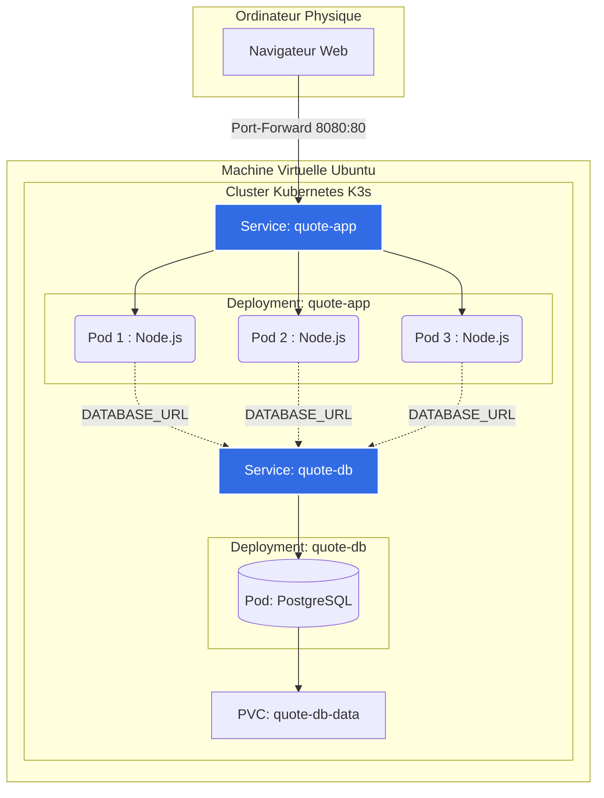

# Architecture Notes - Lab 52

## 1. Architecture Diagram

**Traffic Paths vs. Boundaries:**
- Le "Port-forward" (tunnel temporaire) envoie le trafic depuis l'hôte (laptop) directement au Service `quote-app`, qui sélectionne un Pod spécifique. Cela ne démontre pas la répartition de charge (load-balancing) du Service.
- Le trafic interne (In-cluster) de l'application vers la base de données passe par le service DNS interne de Kubernetes via `DATABASE_URL`.

## 2. Kernel & Boundaries
Les conteneurs de l'application (`quote-app`) et de la base de données (`quote-db`) partagent tous le même noyau invité (guest kernel) de la machine virtuelle Ubuntu. L'hyperviseur (VirtualBox) fournit la frontière d'isolation matérielle de la VM, tandis que Kubernetes gère et isole logiquement les charges de travail à l'intérieur de cette VM via les namespaces et cgroups.

## 3. Resilience & Failure Boundaries (What survives?)
- **Remplacement de Pod :** Un pod `quote-app` supprimé est immédiatement recréé par le `ReplicaSet` de son Déploiement sans perte de service. 
- **Persistance des données :** La citation survit au remplacement du pod `quote-db` car les données sont écrites sur un PersistentVolumeClaim (PVC) attaché dynamiquement au nouveau pod.
- **Perte de la VM / Disque :** Étant donné que le stockage utilise la classe `local-path` sur un cluster à nœud unique (une seule VM K3s), la perte de la VM ou le crash du disque virtuel entraîne la perte irréversible des données. La haute disponibilité multi-nœuds et les sauvegardes de production relèvent de travaux futurs.

## 4. Verification Evidence & Checkpoints
- **Lab 42 (Lanes A & B) :** Validés. Les ressources (Requests/Limits) et les sondes (Liveness/Readiness sur `/health`) sont configurées dans `../42-kubernetes/deployment.yaml`.
- **Database Status :** 
  - PVC `quote-db-data` est au statut `Bound`.
  - Base de données déployée avec succès.
- **End-to-End Integration Check :** 
  - Quote marker généré : `res509-1792399299`
  - Marker inséré dans PostgreSQL via l'application et lu avec succès depuis le code HTML de l'accueil (`
res509-1792399299
`).

## 5. Next Action / Limitation
**Action suivante / Limitation principale :** L'architecture actuelle repose sur un seul nœud (Single Point of Failure). La prochaine étape consisterait à ajouter un nœud *worker* au cluster K3s pour séparer les charges applicatives des charges de base de données, et utiliser un stockage distribué ou externe managé.

## 6. Single Point of Failure (SPOF) & Improvement
**SPOF Identifié :** L'architecture actuelle repose sur un nœud Kubernetes unique (la VM Ubuntu). Si cette machine virtuelle s'éteint ou si son disque dur lâche, l'ensemble des pods (application et base de données) tombe en panne. Le stockage `local-path` du PVC lie irrémédiablement les données à cette seule VM.

**Amélioration possible :** Déployer un cluster multi-nœuds (ex: 1 Control Plane et 2 Workers) avec des règles d'anti-affinité pour que les réplicas `quote-app` soient répartis sur des machines différentes. Pour la base de données, utiliser un stockage distribué (comme Longhorn) ou un service PostgreSQL managé externe.

**Trade-off (Compromis) :** Cette haute disponibilité augmenterait considérablement la consommation de ressources matérielles (RAM/CPU) sur la machine hôte. De plus, cela complexifie la gestion de l'infrastructure et introduit une latence réseau supplémentaire entre les nœuds.

## pour tester: kubectl port-forward svc/quote-app 8080:80 --address 0.0.0.0 